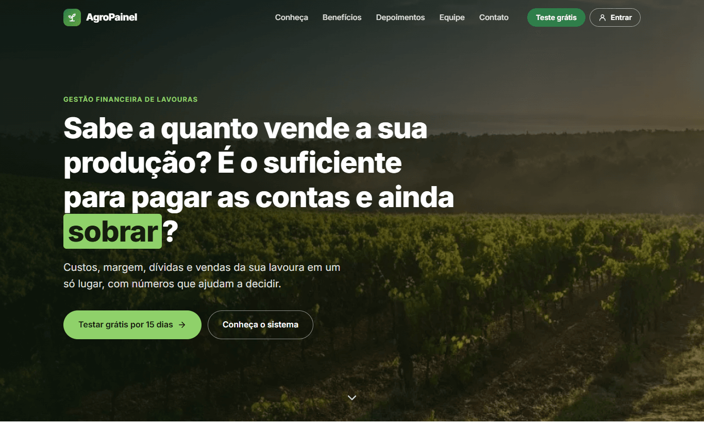
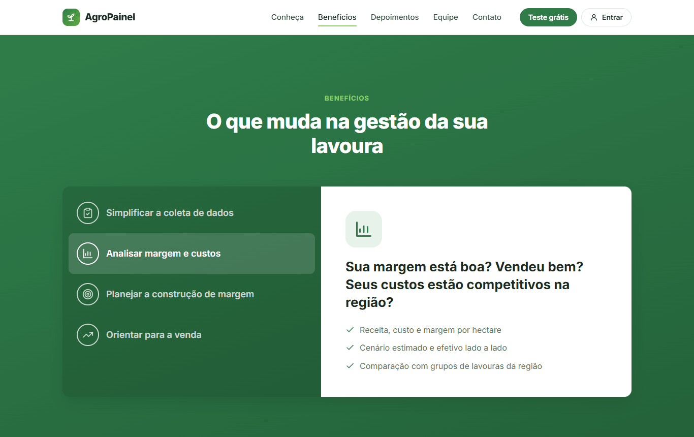
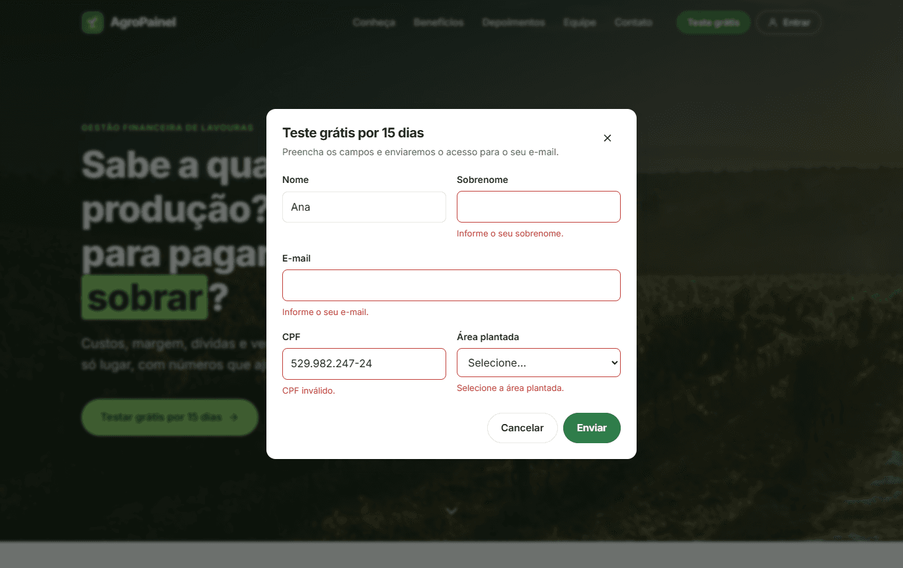
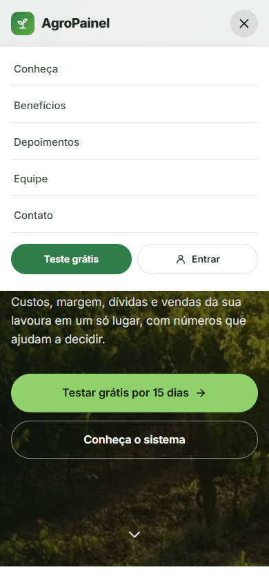
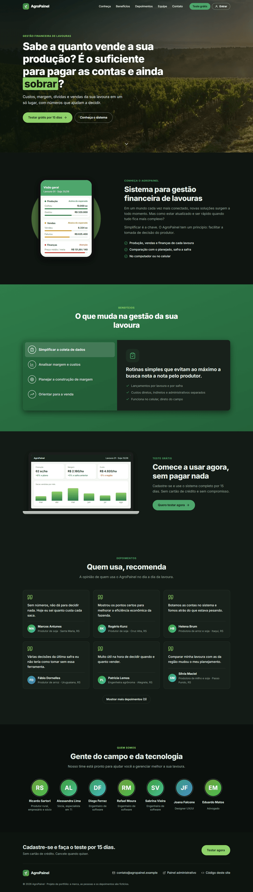

# AgroPainel · Site

Landing page de um sistema de gestão financeira de lavouras: apresentação do produto, benefícios, depoimentos, equipe e cadastro para teste grátis.



> Projeto de portfólio. Nasceu em 2019 como o site institucional de um produto real (Angular 6) e foi **reescrito em Angular 22** com componentes standalone, signals, Signal Forms e change detection zoneless. A marca, as pessoas e os depoimentos originais foram removidos, e todo o conteúdo é fictício. É o site do mesmo produto do [AgroPainel](https://github.com/CristianAndrade23/agro-painel), o painel administrativo.

## Seções

| Seção | O que faz |
|---|---|
| **Header** | Menu fixo que fica sólido ao rolar, destaca a seção visível (scroll spy) e vira um menu recolhível no celular, que fecha com Esc. |
| **Conheça** | Apresentação do produto, com o app no celular desenhado em HTML/CSS. |
| **Benefícios** | Abas acessíveis (padrão WAI-ARIA): setas, Home e End no teclado; `aria-selected` e foco gerenciados. |
| **Comece** | Chamada para o teste grátis, com o sistema no notebook desenhado em HTML/CSS. |
| **Depoimentos** | Cards com "Mostrar mais", que carrega os depoimentos restantes. |
| **Equipe** | Avatares com iniciais e cor derivada do nome, sem fotos de pessoas reais. |
| **Cadastro** | Um único diálogo, aberto de três lugares, com validação por Signal Forms: campos obrigatórios, e-mail, máscara e dígitos verificadores do CPF. O envio é simulado. |

| | |
|---|---|
|  |  |

<p align="center">
  
  &nbsp;&nbsp;
  
</p>

## Stack e decisões técnicas

- **Angular 22**: 100% **standalone components**, sem `NgModule`.
- **Signals em todo o estado**: `signal`, `computed`, `input()`, `model()`, `viewChild()` e `viewChildren()`.
- **Signal Forms** (`@angular/forms/signals`): o modelo do cadastro é um signal, as regras ficam num schema (`required`, `email` e um `validate` próprio para o CPF), e o envio usa `submit()`, que marca os campos e expõe `submitting()`.
- **Zoneless**: sem `zone.js`, com `OnPush` em todos os componentes.
- **Nova sintaxe de template**: `@if`, `@for`, `@let`.
- **Sem jQuery, Bootstrap ou bibliotecas de UI**: modal sobre `<dialog>` nativo, scroll suave e `scroll-padding` em CSS, e `IntersectionObserver` para o scroll spy e as animações de entrada.
- **CSS próprio** com design tokens, **tema escuro** automático (`prefers-color-scheme`) e respeito a `prefers-reduced-motion`.
- **Acessibilidade**: link "pular para o conteúdo", landmarks, `aria-current` no menu, abas com navegação por teclado, erros ligados a `aria-invalid` e foco preso no diálogo.
- **Testes unitários com Vitest**: CPF, abas, "mostrar mais" e o formulário de cadastro.
- **Testes end-to-end com Cypress**: 13 cenários cobrindo menu, scroll spy, abas, depoimentos, o diálogo nos três pontos de entrada, validações, envio e layout mobile.
- **CI com GitHub Actions**: build, testes unitários e E2E a cada push e pull request.

### Estrutura

```
src/app
├── core/                 # conteúdo (dados fictícios), validação de CPF e estado do cadastro
├── shared/               # ícones, modal (<dialog>), avatar e a diretiva de animação de entrada
└── sections/             # uma pasta por seção da página
    ├── header/  hero/  about/  benefits/  get-started/
    ├── testimonials/  team/  footer/
    └── signup/           # formulário de cadastro (Signal Forms)
```

### O que mudou em relação à versão original (Angular 6)

- `NgModule` + `ngx-bootstrap` + jQuery + Bootstrap 4 + Font Awesome → standalone + signals, sem dependências de UI.
- O mesmo CSS copiado em quatro arquivos → tokens globais e estilos por componente.
- Três cópias do modal de cadastro (duas dependiam de jQuery) e um formulário que não fazia nada → um diálogo com validação e estado de envio.
- Abas controladas por quatro booleanos → um `signal` com o id selecionado e um `computed`, com navegação por teclado.
- Script de animação no scroll com debounce → diretiva com `IntersectionObserver`.
- Botão "Mostrar mais depoimentos" sem ação → funcionando.
- Caminhos `/src/assets/...` que quebravam fotos e vídeos em produção → assets servidos de `public/`.
- Imagem do banner de 715 kB → 102 kB em WebP. O carregamento inicial ficou em cerca de 76 kB transferidos.

## Como rodar

Pré-requisito: **Node.js 24 ou mais recente**.

```bash
npm install
npm start          # http://localhost:4200
```

```bash
npm test           # testes unitários (Vitest)
npm run build      # build de produção em dist/agro-site
```

### Testes end-to-end (Cypress)

```bash
npm run e2e        # sobe o ng serve e roda os testes no Chrome headless
npm run e2e:open   # interface interativa do Cypress
```

Com o app já rodando (`npm start`), também dá para usar `npm run cy:run` ou `npm run cy:open` diretamente.

| Spec | Cobre |
|---|---|
| `landing.cy.ts` | seções, navegação pelo menu, scroll spy, abas com mouse e teclado, depoimentos e equipe |
| `signup.cy.ts` | abertura pelos três botões, fechamento, validações, máscara de CPF, envio e formulário limpo ao reabrir |
| `responsive.cy.ts` | menu mobile, Esc e ausência de rolagem horizontal |

> Os scripts usam [`scripts/cypress.mjs`](scripts/cypress.mjs), que remove a variável `ELECTRON_RUN_AS_NODE` herdada do terminal do VS Code. Sem isso, o Cypress falha com `bad option: --smoke-test`.

## Licença

[MIT](LICENSE)
